# Matrix New York

**Driving through New York City inside a world model.**

Pick a spot in NYC, either a curated one, a random one, or your own lat/lon. We grab the real Google Street View panorama with [streetlevel](https://github.com/sk-zk/streetlevel), erase the vehicles right around the camera, render a 3D car from [MeshFleet](https://huggingface.co/datasets/DamianBoborzi/MeshFleet) in a third-person chase-cam view, and composite it in. That single frame goes to [Matrix-Game-3.0](https://huggingface.co/Skywork/Matrix-Game-3.0), an action-conditioned interactive world model, which generates every frame after it. You drive with W (throttle), steering (camera yaw), and short strafes for lane changes.

**Project page with videos: https://mehmetkeremturkcan.com/matrix-new-york/**

## Results

Every clip is ~25 s (417 frames at 17 fps, 10 Matrix-Game-3 iterations, 3 denoising steps), rendered from one Street View frame. The last two show the `--random` and `--lat/--lon` input modes. Click a still to play the clip, or watch them all on the [project page](https://mehmetkeremturkcan.com/matrix-new-york/).

<table>
<tr><td width="33%"><a href="https://mehmetkeremturkcan.com/matrix-new-york/videos/fdr_drive_highway.mp4">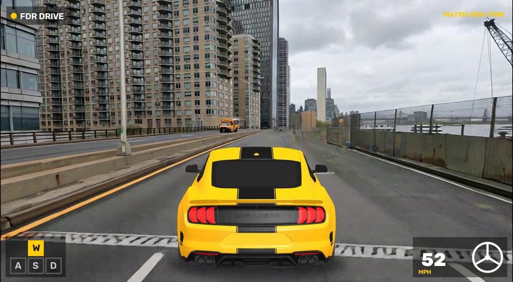<br><sub><b>FDR Drive along the East River</b> · highway · route <code>highway</code></sub></a></td><td width="33%"><a href="https://mehmetkeremturkcan.com/matrix-new-york/videos/times_square_downtown.mp4">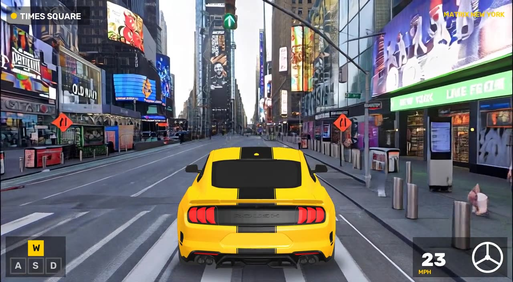<br><sub><b>Seventh Avenue through Times Square</b> · downtown · route <code>downtown</code></sub></a></td><td width="33%"><a href="https://mehmetkeremturkcan.com/matrix-new-york/videos/gowanus_expressway_highway.mp4">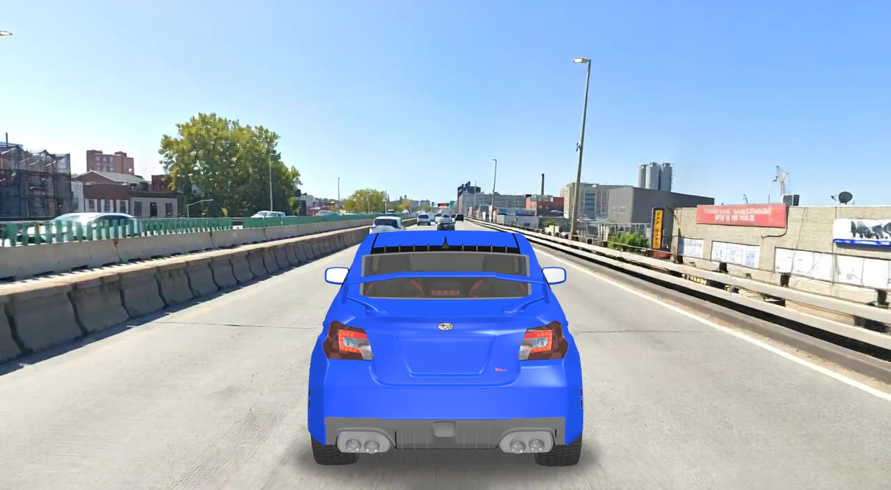<br><sub><b>Gowanus Expressway, Brooklyn</b> · highway · route <code>highway</code></sub></a></td></tr>
<tr><td width="33%"><a href="https://mehmetkeremturkcan.com/matrix-new-york/videos/fifth_avenue_downtown.mp4">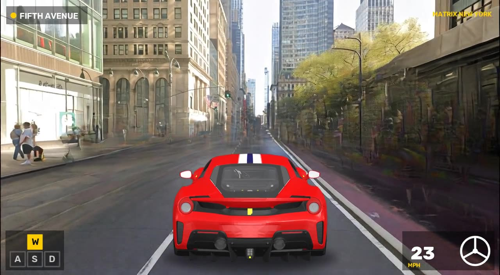<br><sub><b>Fifth Avenue, Midtown</b> · downtown · route <code>downtown</code></sub></a></td><td width="33%"><a href="https://mehmetkeremturkcan.com/matrix-new-york/videos/henry_hudson_pkwy_highway.mp4">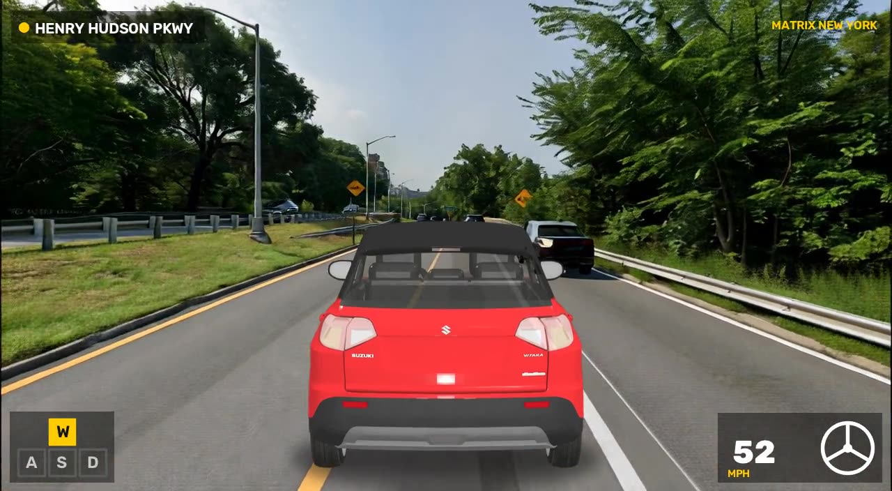<br><sub><b>Henry Hudson Parkway</b> · highway · route <code>highway</code></sub></a></td><td width="33%"><a href="https://mehmetkeremturkcan.com/matrix-new-york/videos/park_avenue_downtown.mp4">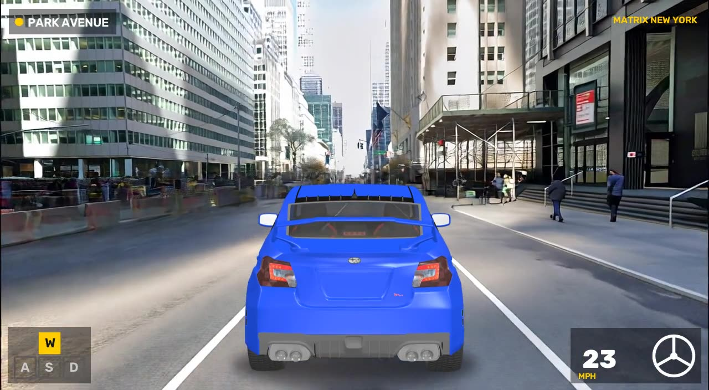<br><sub><b>Park Avenue</b> · downtown · route <code>downtown</code></sub></a></td></tr>
<tr><td width="33%"><a href="https://mehmetkeremturkcan.com/matrix-new-york/videos/canal_street_cruise.mp4">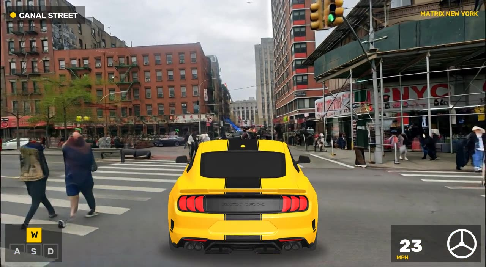<br><sub><b>Canal Street, Chinatown</b> · downtown · route <code>cruise</code></sub></a></td><td width="33%"><a href="https://mehmetkeremturkcan.com/matrix-new-york/videos/fdr_drive_weave.mp4">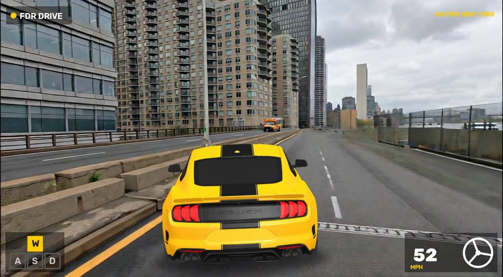<br><sub><b>FDR Drive, weaving through lanes</b> · highway · route <code>weave</code></sub></a></td><td width="33%"><a href="https://mehmetkeremturkcan.com/matrix-new-york/videos/soho_broadway_downtown.mp4">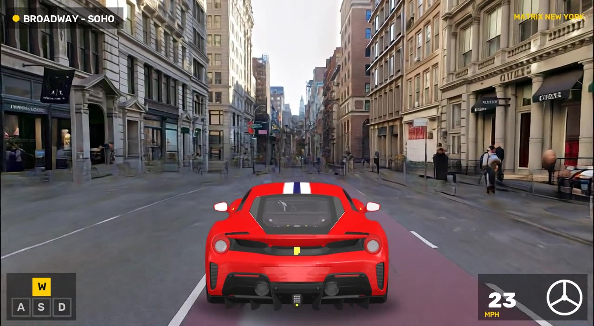<br><sub><b>Broadway, SoHo</b> · downtown · route <code>downtown</code></sub></a></td></tr>
<tr><td width="33%"><a href="https://mehmetkeremturkcan.com/matrix-new-york/videos/dumbo_cruise.mp4">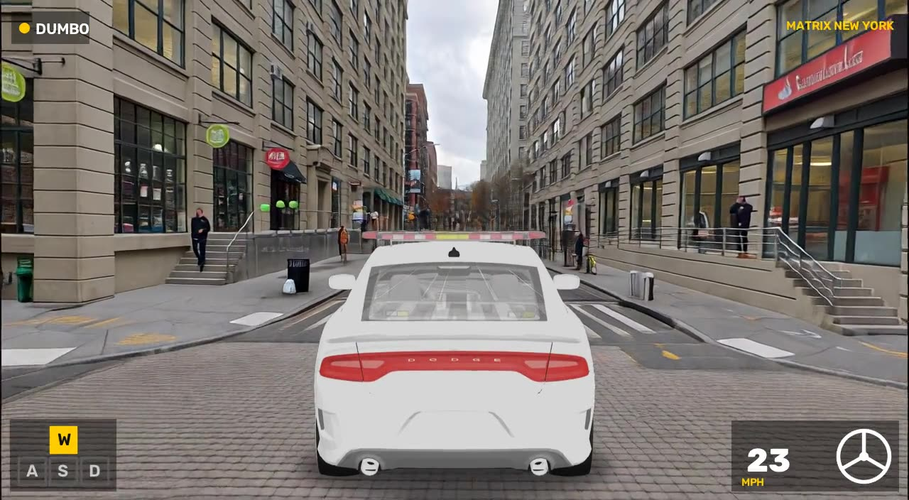<br><sub><b>DUMBO cobblestones, Brooklyn</b> · downtown · route <code>cruise</code></sub></a></td><td width="33%"><a href="https://mehmetkeremturkcan.com/matrix-new-york/videos/times_square_sightseeing.mp4">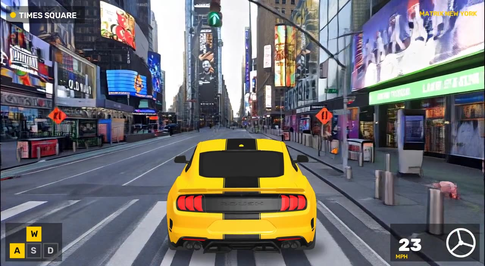<br><sub><b>Times Square, looking around</b> · downtown · route <code>sightseeing</code></sub></a></td><td width="33%"><a href="https://mehmetkeremturkcan.com/matrix-new-york/videos/random_40.67570_-73.92808_cruise.mp4">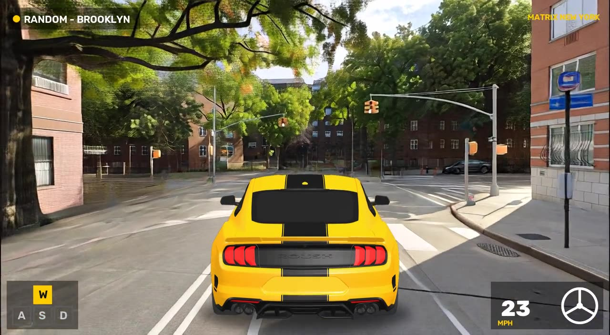<br><sub><b>Random spot: Crown Heights, Brooklyn</b> · random & custom · route <code>cruise</code></sub></a></td></tr>
<tr><td width="33%"><a href="https://mehmetkeremturkcan.com/matrix-new-york/videos/herald_square_downtown.mp4">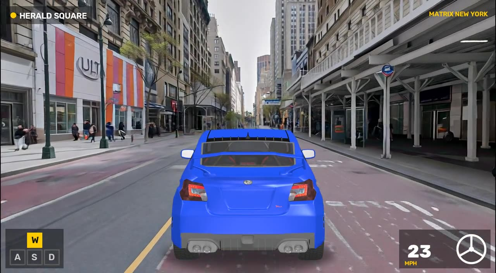<br><sub><b>Custom lat/lon: Herald Square</b> · random & custom · route <code>downtown</code></sub></a></td></tr>
</table>

**About the player car.** Matrix-Game-3.0 is a first-person world model. It treats the car composited into the first frame as part of the static world and drives straight through it, which leaves a smear after about a second. So the car goes into the first frame, where it conditions the model, and the same RGBA car layer (`car_layer.png`) is then re-drawn on every generated frame, the way a game engine draws the player model over the world. It leans and shifts a little with steering and lane changes ([`nycdrive/player.py`](nycdrive/player.py)). The raw world-model output is also saved as `<name>_world.mp4`. Pass `--no_player_layer` to skip the overlay.


## How it works

```
lat/lon ──► streetlevel (coverage tiles → official car pano) ──► equirect pano ──► perspective crop (heading = road direction, 1280×704)
                                                   │
                                Mask2Former (Cityscapes) vehicle masks, near-camera only
                                                   │
                                          LaMa inpainting (erase nearby cars)
                                                   │
          MeshFleet car ──► pyrender chase-cam RGBA sprite ──► composite + contact shadow
                                                   │
                                     first frame + text prompt
                                                   │
             driving actions (W / steer / lane change) ──► Matrix-Game-3.0 ──► world frames
                                                   │
                         player-car layer + HUD re-drawn on each frame ──► game video
```

Note: Google has shut down the single-image search endpoint behind `streetview.find_panorama`. `prepare_inputs.py` instead looks up panoramas through streetlevel's coverage-tile API, which returns only official Google-car captures, and prefers panos on the named road (e.g. "FDR"), so a highway wins over the service road next to it.

| Stage | File |
|---|---|
| Street View fetch, reprojection, masking, inpainting, compositing | [`nycdrive/prepare_inputs.py`](nycdrive/prepare_inputs.py) |
| MeshFleet chase-cam car renderer | [`nycdrive/car_render.py`](nycdrive/car_render.py) |
| Driving routes → Matrix-Game-3 keyboard/mouse action tracks | [`nycdrive/routes.py`](nycdrive/routes.py) |
| Matrix-Game-3 wrapper (batch and interactive car controls) | [`nycdrive/drive.py`](nycdrive/drive.py) |
| Player-car layer re-drawn on each generated frame | [`nycdrive/player.py`](nycdrive/player.py) |
| Game HUD (location, keys, speedometer, steering wheel) | [`nycdrive/hud.py`](nycdrive/hud.py) |
| Multi-GPU batch rendering, site builder | [`scripts/`](scripts/) |

### Actions as car controls

Matrix-Game-3 takes a 6-dim keyboard vector (`W S A D …`) and a 2-dim mouse vector (pitch, yaw; 15°/unit/frame) for every frame. We map them like this:

| Car | Matrix-Game-3 action |
|---|---|
| throttle | `W` |
| brake / reverse | `S` |
| steering wheel | mouse yaw (±0.03 gentle curve, ±0.06 steer, ±0.10 for a 90° intersection turn) |
| lane change | `W` + short `A`/`D` strafe |

Route presets (`cruise`, `highway`, `downtown`, `weave`, `sightseeing`) live in `nycdrive/routes.py`. You can also pass a JSON list of `[seconds, keys, yaw]` segments.

## Setup

```bash
git clone https://github.com/mkturkcan/matrix-new-york && cd matrix-new-york
# Matrix-Game-3 code (only the Matrix-Game-3 folder is needed)
git clone --depth 1 --filter=blob:none --sparse https://github.com/SkyworkAI/Matrix-Game.git third_party/Matrix-Game
git -C third_party/Matrix-Game sparse-checkout set Matrix-Game-3
# weights (~43 GB without base_model/)
hf download Skywork/Matrix-Game-3.0 --local-dir checkpoints/Matrix-Game-3.0 --exclude "base_model/*"
# python deps (install torch + flash-attn for your CUDA first)
pip install -r requirements.txt
```

Tested on 4× RTX PRO 6000 Blackwell (96 GB) with torch 2.12 + CUDA 13.0 and flash-attn 2. One scene fits comfortably on a single GPU, so `scripts/render_showcase.py` runs one scene per GPU in parallel.

## Usage

```bash
# 1. Build first frames
python -m nycdrive.prepare_inputs                                   # curated highway + downtown scenes
python -m nycdrive.prepare_inputs --random                          # random spot in NYC
python -m nycdrive.prepare_inputs --lat 40.7580 --lon -73.9855      # your own spot

# 2a. Drive a scripted route → outputs/videos/<name>_{clean,hud}.mp4
python -m nycdrive.drive --scene data/inputs/<scene> --route highway --num_iterations 10

# 2b. Play interactively: the model pauses after each chunk for your next command
python -m nycdrive.drive --scene data/inputs/<scene> --interactive
#   w gas · s brake · a/d steer · wa/wd turn while accelerating · z/c lane change · q coast

# 3. Batch render + build the project page
python scripts/render_showcase.py configs/showcase.json --gpus 0,1,2,3
python scripts/build_site.py configs/showcase.json --pipeline_scene <scene>
```

Extra flags after `--` are passed straight to Matrix-Game-3's `generate.py`. For example, `-- --use_int8` turns on int8 DiT quantization.

## Limitations

- Every frame after the first is generated. Buildings, signs, and traffic are plausible, not a faithful map of NYC, and the model drifts further from reality the longer you drive.
- Matrix-Game-3 is first-person, so the third-person car is a re-drawn layer (see above), not something the model simulates: it doesn't occlude, reflect, or collide with the generated world.
- Full 90° turns mid-block steer the camera into storefronts and the scene degrades quickly. The `downtown` route therefore sticks to lane changes and gentle steering; `turn_right` is meant for first frames taken at an intersection.
- Dense scenes like Times Square drift toward a stylized, game-like look after ~15 s.
- Street View coverage, capture date, and weather depend on the panorama found nearest the requested point.

## Credits & licenses

- **Matrix-Game-3.0** by Skywork AI: [model](https://huggingface.co/Skywork/Matrix-Game-3.0), [code](https://github.com/SkyworkAI/Matrix-Game), Apache-2.0. Built on Wan2.2.
- **streetlevel** by sk-zk: [repo](https://github.com/sk-zk/streetlevel), MIT. Street View imagery © Google; use it in line with Google's terms of service.
- **MeshFleet** by Boborzi et al. ([dataset](https://huggingface.co/datasets/DamianBoborzi/MeshFleet), [paper](https://arxiv.org/abs/2503.14002)). We used five CC-BY car models that MeshFleet curates from Objaverse-XL / Sketchfab:
  - "Subaru WRX STI" by Skyborg ([Sketchfab](https://sketchfab.com/3d-models/36f4a47b619a49bda4c1870e7833b25b)), CC-BY
  - "SuzukiVitara3DModel" by TuMankito77 ([Sketchfab](https://sketchfab.com/3d-models/6c2f647e8874401abfee51dbe6a0bee9)), CC-BY
  - "Dodge-charger-pov" by lukas.ohmer ([Sketchfab](https://sketchfab.com/3d-models/b1694c78e3184150b8fd518eeee5af06)), CC-BY
  - Ford Mustang GT (MeshFleet sha256 `89f6d9c8…`, originally [Sketchfab f8e521c3…](https://sketchfab.com/3d-models/f8e521c3315e445ea69f630c79b682f0), no longer online), CC-BY per MeshFleet metadata
  - Ferrari 488 (MeshFleet sha256 `e7d2897c…`, originally [Sketchfab 0045292d…](https://sketchfab.com/3d-models/0045292de2114f0c83a9e5413eb043d4), no longer online), CC-BY per MeshFleet metadata
- **Mask2Former** (Meta, Cityscapes semantic checkpoint) and **LaMa** (Samsung AI, via `simple-lama-inpainting`) for masking and inpainting.

The code in this repository is released under Apache-2.0. This is an independent research demo, not affiliated with Skywork, Google, or the dataset authors.
